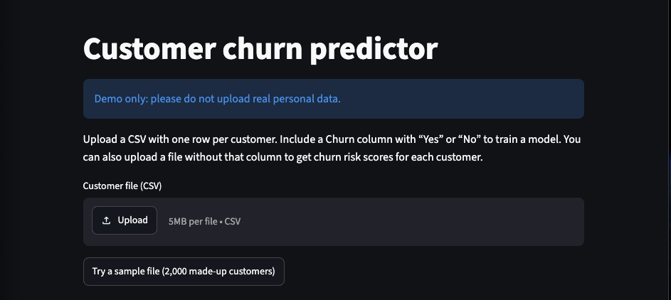
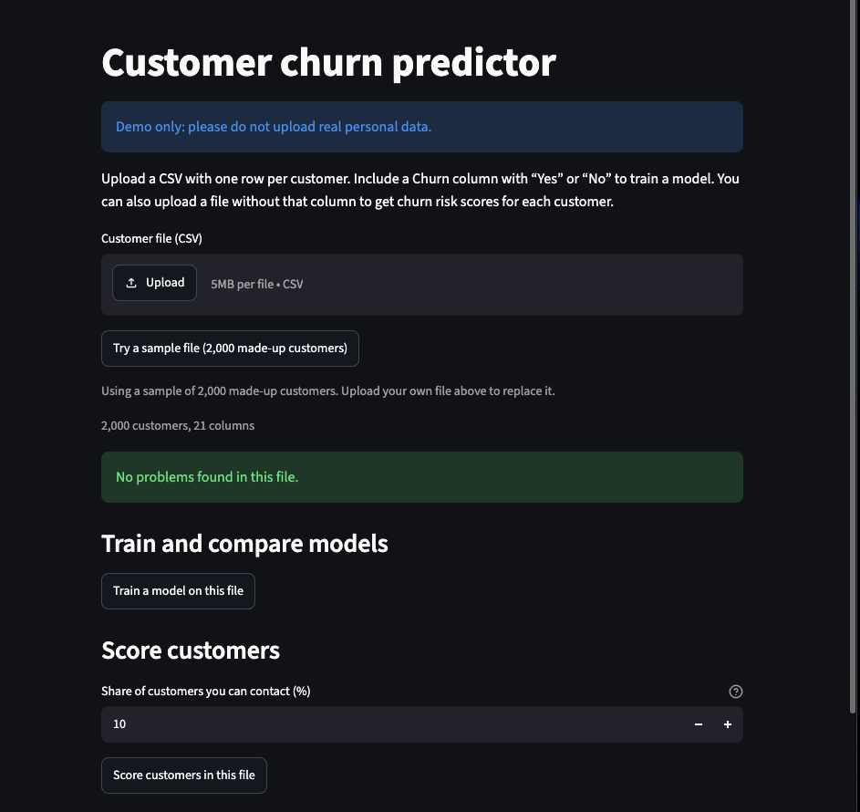
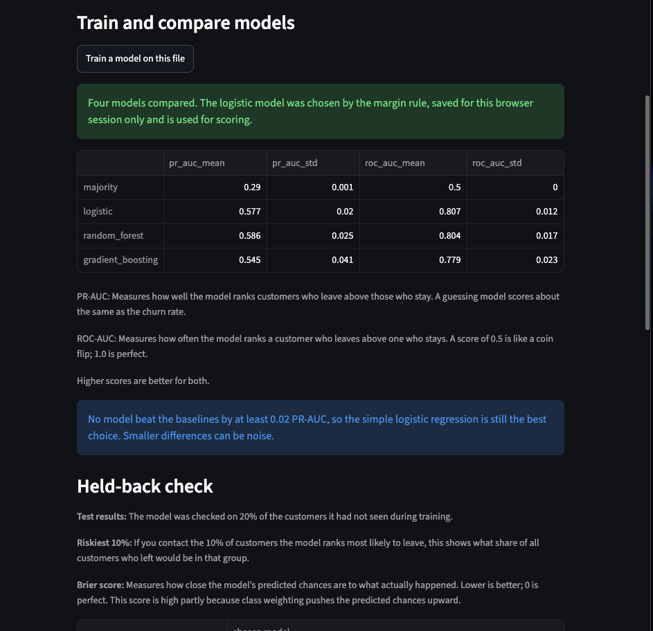
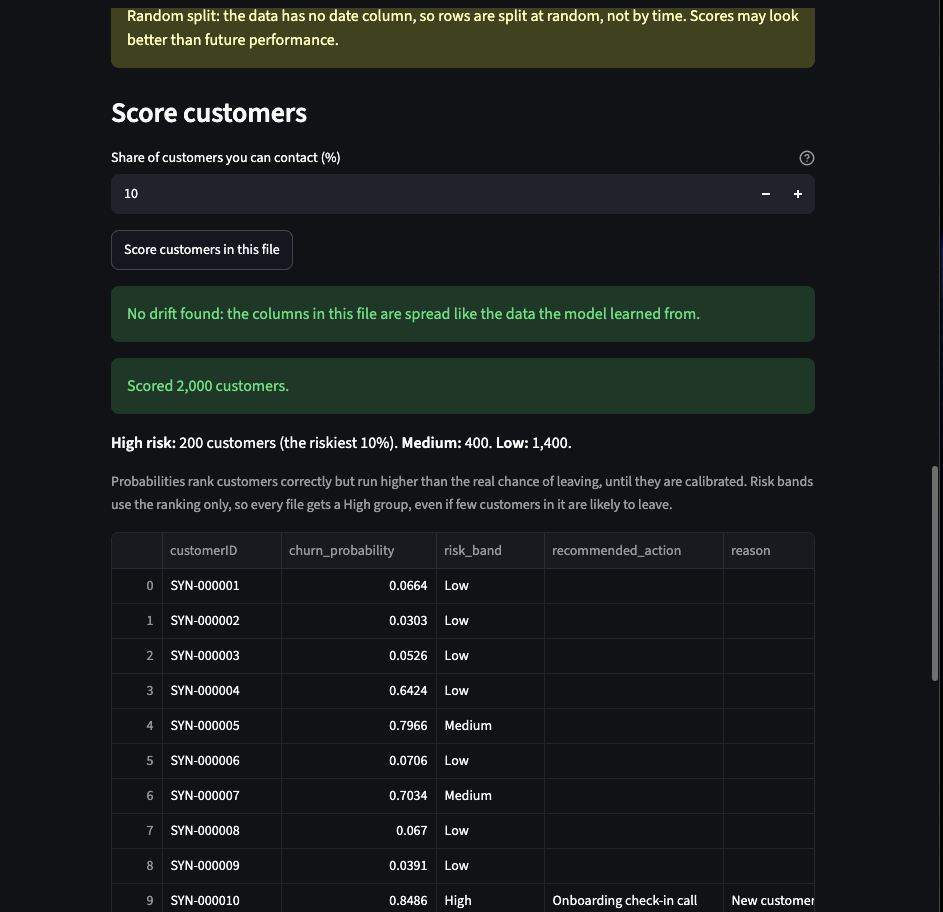
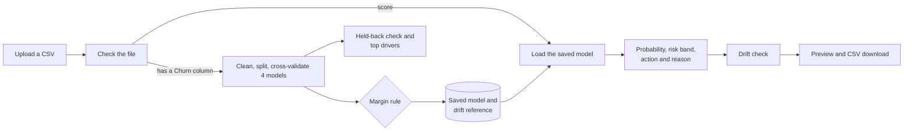

# Customer Churn Prediction Platform

[](https://github.com/shoaibhassancs/customer-churn-prediction-platform/actions/workflows/ci.yml)

Upload a CSV of customers and get back who is likely to leave, how risky each
customer is, which columns drive churn, and a suggested retention action for the
riskiest customers. A solo portfolio project, built step by step to practise Python
and machine learning with care about the details that make results trustworthy.

**Live demo: <https://customer-churn-prediction-kgaz.onrender.com>**. It runs on a free
host that sleeps when idle, so the first load after a quiet spell can take about a
minute. Click **Try a sample file** to use it without any data.

## What it does

- **Checks your file** and explains any problem in plain language, with a suggested fix.
- **Trains and compares four models** (a majority-class guess, logistic regression,
  random forest and gradient boosting) with the same cross-validation folds, then
  scores the chosen model once on 20% of customers it never saw.
- **Chooses the scoring model by a fixed rule:** logistic regression, unless another
  model beats both baselines by at least 0.02 PR-AUC.
- **Scores every customer** with a churn probability and a High, Medium or Low risk
  band, and gives each High-risk customer an action and the reason for it.
- **Ranks the columns that drive churn,** and says how stable that ranking is.
- **Warns about drift** when a file being scored looks different from the data the
  model learned from.
- **Lets you try it without data:** a "Try a sample file" button loads 2,000 made-up
  customers.

## Screenshots

These come from the live demo using the built-in sample of 2,000 made-up customers, so
the scores differ from the Telco results below.

**1. Start with a file of your own, or the sample.** Uploads are capped at 5 MB on the
free host.



**2. The file is checked before anything runs.** Problems would be listed here with a
fix. Then you can train a model, score customers, or both.



**3. Four models are compared, and the rule picks one.** On this sample no challenger
beat the baselines by 0.02 PR-AUC, so logistic regression was kept. The model is saved
for this browser session only.



**4. Every customer gets a score, a risk band and, if High risk, an action with a reason.**
The drift check says the sample looks like the data the model learned from.



## How it works



One Streamlit app, no API and no database. The screen only calls tested functions in
`src/churn_platform/workflow.py`.

## Results on the Telco dataset

Logistic regression was chosen: no other model beat it by the 0.02 margin. PR-AUC
(average precision) is the main metric because only about 27% of customers churn, so
plain accuracy would flatter a model that predicts "stays" for everyone.

| Model | PR-AUC (5-fold, training rows) | ROC-AUC |
| --- | --- | --- |
| Majority-class guess | 0.265 | 0.500 |
| **Logistic regression (chosen)** | **0.660** | **0.846** |
| Random forest | 0.653 | 0.845 |
| Gradient boosting | 0.648 | 0.838 |

On the held-back 20% (1,409 customers, 374 of whom churned), the chosen model gets
PR-AUC 0.633 and ROC-AUC 0.842. The riskiest 10% of customers contain about 29% of
all churners. The model card has the full numbers and the caveats.

## Honest limits

- **It only works on Telco-shaped files.** The column names are the Telco dataset's. Any
  other file gets a clear list of what is missing.
- **Probabilities run too high.** Class weights make the model pay more attention to
  churners, which inflates the numbers. They rank customers well but are not real
  chances, so risk bands use the ranking only and the screen says so.
- **The actions are rules, not evidence.** They are plausible business suggestions. Showing
  that an action keeps customers needs real campaign results.
- **No complex model beat logistic regression** here. The differences were within the
  noise between cross-validation folds.
- **The split is random.** The data has no dates, so scores may look better than future
  performance would.
- **Only the top 5 drivers are stable** across random seeds. The order below that changes.
- **The drift cutoffs (0.1 and 0.25) are common rules of thumb,** checked on Telco only.
- **Training waits on the screen.** On the free demo server, training on the 2,000-customer
  sample takes about 5 minutes (the page stays responsive while it runs). On a laptop
  it takes seconds. Scoring is instant either way.
- **The live demo's built-in model is trained on made-up customers,** not on Telco, so
  its scores are not Telco results.

## Run it

### With Docker

```bash
git clone https://github.com/shoaibhassancs/customer-churn-prediction-platform.git
cd customer-churn-prediction-platform
docker compose up --build
```

Open <http://localhost:8501>. A model is put in place at start-up, so you can click
**Try a sample file** and then **Score** straight away. Models you train are kept in
`models/`, which is git-ignored.

**On Linux,** create the models folder first, so it belongs to you and the container can
write to it: run `mkdir models` before `docker compose up --build`.

### Without Docker

You need Python 3.12 and [uv](https://docs.astral.sh/uv/).

```bash
uv sync
uv run streamlit run src/churn_platform/app.py
```

Click **Try a sample file**, then **Train**, then **Score**.

### The Telco data

The dataset is not included. It is the "Telco Customer Churn" file on
[Kaggle](https://www.kaggle.com/datasets/blastchar/telco-customer-churn) (based on IBM
sample data). Download it yourself, put it at `data/raw/Telco-Customer-Churn.csv`
(git-ignored), and check the terms on its page before reusing it. Everything also works
on the made-up customers from `src/churn_platform/synthetic.py`.

## Checks and tests

```bash
uv run pytest                          # more than 200 tests
uv run ruff check src tests            # lint
uv run ruff format --check src tests   # formatting
uv run mypy                            # types
```

The same checks run on every push in GitHub Actions. A pre-commit hook runs the two
fast ruff checks (`uv run pre-commit install` to switch it on).

## Deploying

`render.yaml` describes a free Docker web service for [Render](https://render.com). It
sets `DEMO_MODE=1`, so every visitor trains a private model for their session and the
built-in demo model is never overwritten, and it limits uploads to 5 MB because the free
plan has 512 MB of memory. Settings are listed in `.env.example`.

## Design choices worth knowing

- **Fit on training rows only.** Scalers and encoders learn from the training split and are
  reused unchanged. One pipeline object does both training and scoring, so they cannot drift apart.
- **Judge by PR-AUC,** with ROC-AUC, recall in the top 10% and Brier score alongside.
- **A margin before a bigger model wins.** A challenger must beat the baselines by 0.02
  PR-AUC, roughly one fold-to-fold standard deviation, so luck cannot pick the model.
- **The held-back rows are looked at once** and nothing is tuned from them.
- **Risk bands by rank,** set by how many customers a team can contact.
- **Every decision is argued** in the project's decision log, which is kept locally.

## License

Code released under the [MIT License](LICENSE). The Telco dataset is not part of this
repository and has its own terms.

## Documents

- [`MODEL_CARD.md`](MODEL_CARD.md): what the model is, its data, numbers and limits.
- [`SCOPE.md`](SCOPE.md): what version 1 includes and what it leaves out.

## Layout

```
src/churn_platform/   the application (app, workflow, ingest, cleaning, models, drift, ...)
tests/                pytest tests, mirroring the package
Dockerfile, compose.yaml, render.yaml, .env.example
.github/workflows/    CI
```
